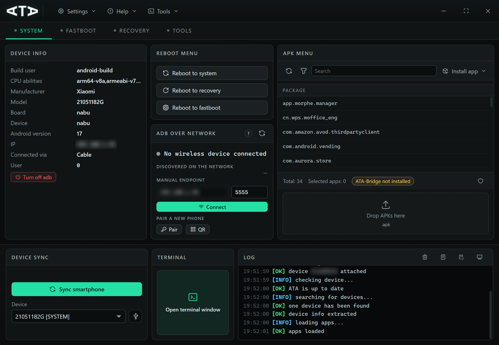
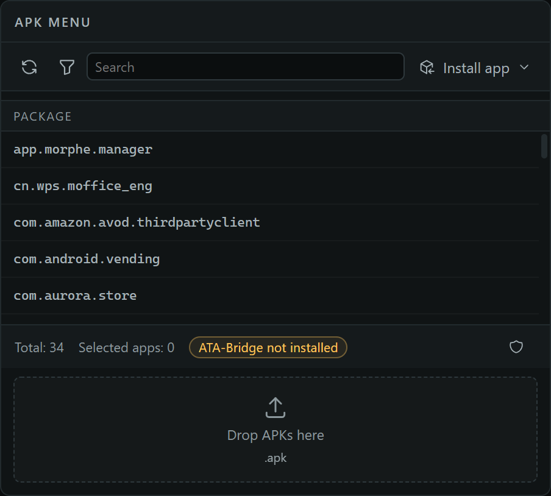
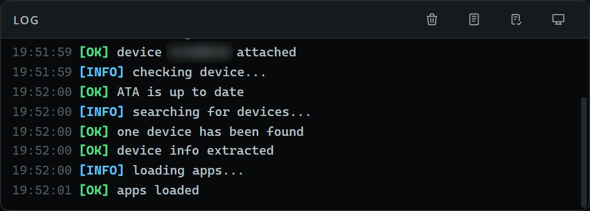
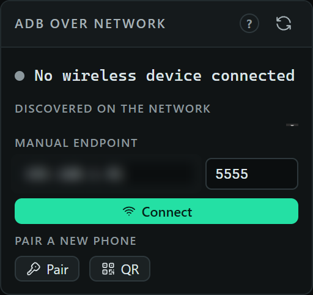

# ATA-GUI

**Android, under control.**

ATA-GUI puts `adb`, `fastboot`, sideload, logcat and screen mirroring behind one calm desktop
window. Remove the apps you never asked for, flash a boot image with progress you can actually
read, watch the device log live, or drop into a real shell without memorising a single command.

[](https://github.com/msartore/ATA-GUI/releases)
[](LICENSE)




---

## The idea

The 3.x app was a WinForms tool that did a lot and froze while doing it. This is the same tool
rebuilt on **Tauri 2 + Rust + React**: same workflows, none of the blocking. Every adb and
fastboot call runs off the UI thread with a watchdog and a cancel button, the window is a native
binary around the system webview (2.4 MB installer), and the whole thing ships for Windows,
Linux and macOS from one codebase.

No account. No telemetry. No bundled SDK you did not ask for: Platform Tools and scrcpy are
downloaded on first use and live beside the app.

## What you get

### Apps, without the command line

The APK manager lists every installed package with search, bulk selection, install-from-file,
uninstall, disable and restore. Split bundles install as one, a drag-and-drop zone takes APKs
straight from Explorer, and the bloatware list from the **Universal Android Debloater** marks what
is safe to remove. No root, no package names to copy.



### Flashing you can watch

Queue boot, recovery, vbmeta or a whole set of partitions, pick a slot, and flash. The panel
follows the tool it is driving (*sending*, *writing*, *done*), with the transfer size, elapsed
time and raw fastboot output, line by line. Sideload an OTA from recovery with a real progress bar,
or pull a partition image off the device and keep the `.img`. Cancel works mid-flight; the child
process dies with it.

### Logs, and a terminal that behaves like one

A dedicated log window streams `logcat` and `getevent`, batches thousands of lines a second without
janking the UI, filters by level and saves to a file. The terminal is a full-height shell surface
with a real prompt, scrollback, ↑/↓ history, Tab completion for adb/fastboot verbs and Ctrl+C that
stops the running command instead of the window.



### Wireless ADB, including QR pairing

Android 11+ can pair without typing a code. **ADB over network → QR** renders the official
`WIFI:T:ADB;S:<service>;P:<password>;;` payload; scan it with *Pair device with QR code*, and the
app discovers the new endpoint over mDNS, pairs, connects and refreshes the device list. Manual
`ip:port` connect, `adb tcpip`, IP history and readable failure hints are all there too.



### The rest of the bench

- **Device info** in system and fastboot modes, per user, with a multi-device selector.
- **Permissions**: inspect, grant and revoke runtime permissions; set default app roles.
- **Screen and camera mirroring** through scrcpy, with encoder discovery and a visible download.
- **Bootloader tools**: unlock, lock, OEM device-info and the current state of the unit.
- **Task manager**: what is running, and one click to stop it.
- **Eight languages** (English, Italian, Spanish, German, French, Portuguese, Russian, Chinese),
  switchable at runtime; drop a JSON file in `locales/` to add your own.
- **Dark, light or system theme**, applied before the first paint and mirrored onto the native
  window and every detached window.
- **Portable build**: `config.json`, locales and downloads live next to the executable, so the whole
  thing travels on a USB stick.

## Built to stay out of the way

| | |
| --- | --- |
| **Nothing blocks the UI** | every adb/fastboot call is spawned off the main thread |
| **Every long job is cancellable** | installs, pushes, flashing and extractions run through a guarded wrapper with a watchdog, drained pipes and a process-tree kill |
| **One row per phone** | the same device seen over cable, `ip:port` and mDNS is collapsed by `ro.serialno` |
| **It remembers its window** | size, position and maximised state, clamped to the 1040×720 minimum |
| **One instance, no consoles** | a second launch focuses the running window; no console flashes for child tools |
| **Strict CSP** | the webview only loads bundled assets |

## Install

| Platform | Recommended | Also provided |
| --- | --- | --- |
| Windows 10/11 x64 | `ATA-GUI_<version>_x64-setup.exe` (per-user NSIS) | `.msi`, portable `.zip` |
| Linux x64 | `.AppImage` or `.deb` | `.rpm`, portable `.tar.gz` / `.zip` |
| macOS 11+ (Apple silicon) | `.dmg` | portable `.zip` containing `ATA-GUI.app` |

Downloads are on the [releases page](https://github.com/msartore/ATA-GUI/releases). Portable builds
are self-contained; the Windows `.zip` keeps `ATA-GUI.exe` at its root so the 3.x in-place updater
still works.

Platform notes, the portable layout, macOS quarantine and the 3.x upgrade path:
[`docs/INSTALL.md`](docs/INSTALL.md).

## Build from source

Node 22+, Rust 1.80+ and the platform toolchain (MSVC on Windows, GTK/WebKit on Linux).

```bash
npm ci
npm run desktop:dev      # Tauri window with hot reload
npm run build            # type-check + bundle the frontend
npx tauri build          # app + installers
npm run package          # release/: portable archive + installers, in publish order
npm run check:locales    # catalogue parity, duplicates and dead keys
```

Prerequisites per platform, the test suite and CI: [`docs/BUILD.md`](docs/BUILD.md).

## Documentation

| Document | Contents |
| --- | --- |
| [`docs/FEATURES.md`](docs/FEATURES.md) | the full tour: every panel, behaviour and shortcut |
| [`docs/INSTALL.md`](docs/INSTALL.md) | bundles, portable config, macOS, upgrading from 3.x, updates |
| [`docs/BUILD.md`](docs/BUILD.md) | prerequisites, development loop, tests, packaging |
| [`docs/RELEASING.md`](docs/RELEASING.md) | versioning, tag workflow, the release asset contract |
| [`docs/ARCHITECTURE.md`](docs/ARCHITECTURE.md) | source tree, process layer, conventions |
| [`docs/TRANSLATIONS.md`](docs/TRANSLATIONS.md) | adding or overriding a language |
| [`docs/PORTING.md`](docs/PORTING.md) | mapping from the WinForms forms |
| [`CHANGELOG.md`](CHANGELOG.md) | release notes |

The 3.x C# sources are on the **`legacy`** branch; `main` is the Tauri rewrite.

## Credits

Massimiliano Sartore · icons by [Tabler Icons](https://tabler.io/icons) (MIT) · debloat list by the
[Universal Android Debloater Alliance](https://github.com/Universal-Debloater-Alliance/universal-android-debloater-next-generation)
· screen mirroring by [scrcpy](https://github.com/Genymobile/scrcpy) · powered by
[SDK Platform Tools](https://developer.android.com/studio/releases/platform-tools).

## License

Apache-2.0. See [LICENSE](LICENSE).
