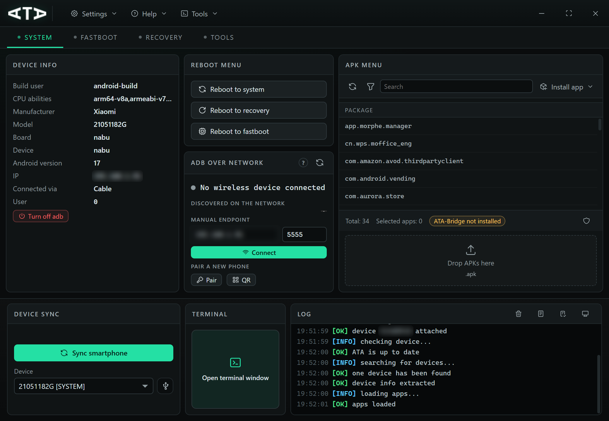
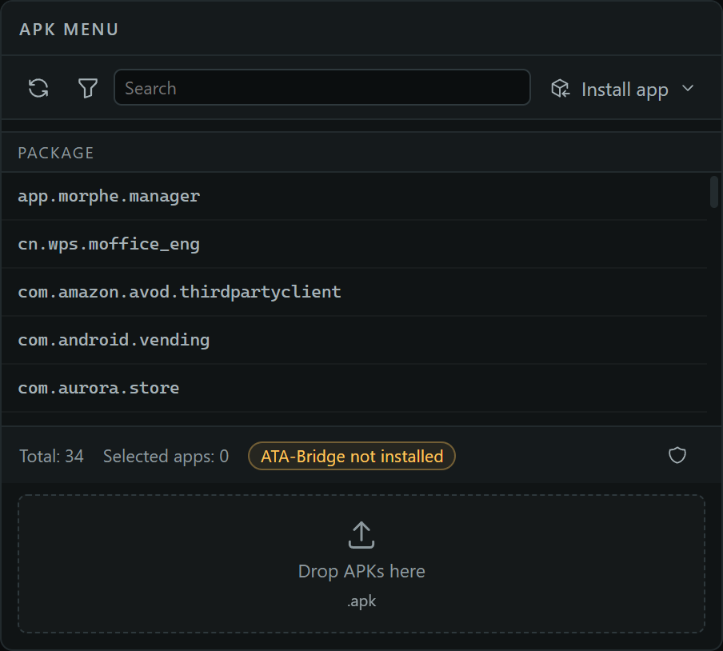
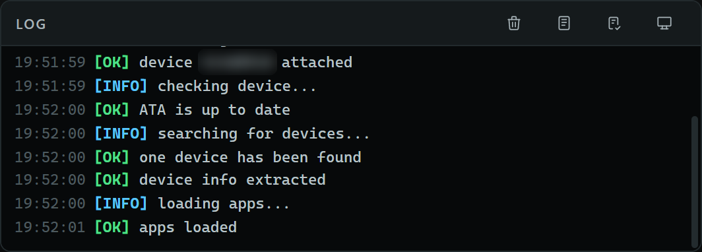
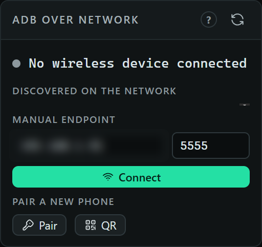

# The tour

A walk through what the app shows and what each control does. For the one-paragraph pitch and
install instructions, see the [README](../README.md).



## The system tab

Everything about a connected phone on one screen.

| Panel | What it does |
| --- | --- |
| **Device info** | build user, CPU ABIs, manufacturer, model, board, device, Android version, IP, transport (cable or wireless), active user. **Turn off adb** stops the daemon; the watcher stays dead until you list devices again. |
| **Reboot menu** | reboot to system, recovery or fastboot, with a confirmation for wireless devices. |
| **ADB over network** | discovered mDNS endpoints, a manual `ip:port` connect, IP history, and pairing for Android 11+. |
| **APK menu** | the installed package list, bulk selection, install/uninstall/disable, drag-and-drop, and the bloatware verdicts. |
| **Device sync** | pulls the app list and device info again for the selected phone, or for a different one. |
| **Terminal** | opens the shell in its own window. |
| **Log** | the live, level-tagged log of everything the app is doing. |

## Apps and packages



- Every installed package, system and user, per Android user.
- Search, bulk selection, select-all, and per-row state (`installed`, `disabled`, `system`).
- **Install app** takes a single APK or a split bundle (`.apks`, `.xapk`, `.apkm`); dropping files
  on the dashed zone does the same.
- Uninstall, disable, enable and restore, one or many at a time, each with its own result.
- The **Universal Android Debloater** list marks packages by recommendation, so you can see what is
  safe to remove before you touch it.
- **Extract APKs** saves the selected packages to the APKs folder and offers to open it.

The list is virtualised: an 800-package device renders only the rows you can see.

## Flashing and recovery

The **Fastboot** tab is a queue: add boot, recovery, vbmeta, dtbo or any other image, choose the
slot (`all` expands to `_a`/`_b`), and flash. The run panel reports what fastboot reports
(`Sending 'boot' (96 KB)`, `Writing 'boot'`, `Finished.`), plus elapsed time, the size of each image
and the raw tool output. Cancel kills the child process, not just the UI.

The **Recovery** tab handles the recovery story: sideload an OTA zip with a real progress bar, and
extract a partition image (boot, recovery, vbmeta, …) straight to disk. Both run through the same
guarded wrapper, so a slow device is a wait, not a hang.

## Logs and the terminal



- **Logcat / GetEvent** open in a detached window: level-tagged, filterable, capped at 6000 lines
  in memory with only the tail rendered, and saved to a file from the toolbar.
- The **terminal** is a real shell surface: inline prompt (`ata@<host>:~$`), scrollback, ↑/↓ history,
  Tab completion for adb and fastboot verbs and their closed argument sets, Ctrl+L to clear,
  Ctrl+C to stop the running command, and a status bar that switches between adb and fastboot.
- Long output streams while it runs: `logcat` keeps printing and the prompt comes back when you
  stop it.

## Wireless ADB



- **Discovered on the network** lists mDNS endpoints (`_adb-tls-connect._tcp`). Android 11+ picks a
  random port instead of 5555, which is why manual connects usually fail. The list shows the real
  endpoint.
- **Manual endpoint** remembers the last IP and lets you connect, disconnect and check the daemon.
- **Pair a new phone** types a 6-digit code, or shows a QR code:

```text
WIFI:T:ADB;S:<service-name>;P:<password>;;
```

The phone scans it from *Wireless debugging → Pair device with QR code*, advertises
`_adb-tls-pairing._tcp`, and the dialog follows the pairing live: waiting → paired → connected →
device appears in the list. Regenerate the code at any time.

## Devices

One row per physical phone. adb can report the same device three ways (over the cable, as
`ip:port`, and as an mDNS service name), so the list is merged by `ro.serialno`, preferring the
cable transport. Each row can be selected as the target for every action in the window.

## Interface

- **Themes**: dark, light or follow the system. Applied before the first paint, mirrored onto the
  native window frame and pushed to the detached windows; in system mode it follows OS changes live.
- **Languages**: eight bundled catalogues (English, Italian, Spanish, German, French, Portuguese,
  Russian, Chinese) loaded at runtime. Files dropped into `locales/` overlay the bundled ones, so a
  translation can be fixed without a rebuild. See [TRANSLATIONS.md](TRANSLATIONS.md).
- **Responsive**: the layout holds from 1040×720 upward: the dock gives height back to the
  workspace, columns narrow before they stack, and toolbar buttons drop their label to keep the
  icon.

## Desktop behaviour

- **Cancellable work**: installs, pushes, image extraction, flashing and sideloading run through a
  guarded process wrapper with a watchdog (20–45 minutes depending on the task), drained pipes and a
  process-tree kill.
- **Nothing on the UI thread**: every adb/fastboot spawn is off the main thread.
- **Single instance**: a second launch focuses the running window.
- **Remembered window**: size, position and maximised state, clamped to the minimum.
- **No console windows**: the binary is GUI-subsystem and every child tool is spawned hidden.
- **Strict CSP**: the webview only loads bundled assets.

## Keyboard shortcuts

| Keys | Action |
| --- | --- |
| `Ctrl+F` | focus the app search box |
| `F5` | rescan devices |
| `Ctrl+L` | clear the log |
| `Ctrl+1…4` | System / Fastboot / Recovery / Tools |
| `Esc` | close the open dialog |

## Where things live

| | |
| --- | --- |
| `config.json` | settings, theme, language and IP history; beside the executable in a portable build, otherwise in the per-user config directory |
| `locales/` | bundled catalogues plus any file you drop in to override or add a language |
| `platform-tools/`, `scrcpy/` | downloaded on first use, next to the app |
| APK exports | the APKs folder chosen in **Settings**, opened from the snackbar after an extraction |
